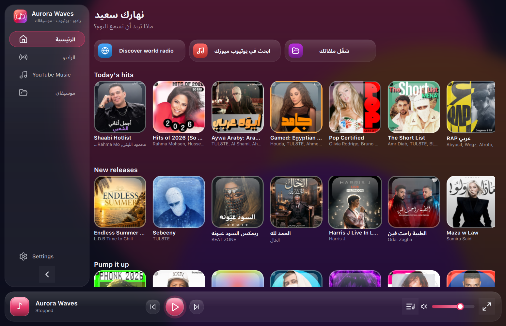

# Aurora Waves — أمواج أورورا

**World radio, YouTube Music and your own music in one frosted-glass desktop player for Linux.**
The desktop sibling of the [Aurora Waves Plasma widget](https://github.com/elblasy33/aurora-waves):
the same engine and look, with room to breathe. It runs on any desktop (GNOME, KDE, Xfce…).

<p align="center"></p>

## Features

- **World radio**: tens of thousands of stations (Radio Browser and zeno.fm) by name, country and
  genre; your stations as glass cards; Egypt's official public radio in one click; check & repair
  that listens to every station.
- **YouTube Music** (optional): search, artists, albums, playlists, a home feed in your language,
  queues, similar-song radio, **synced lyrics**; optional sign-in for your library.
- **My Music**: files, folders and M3U/PLS playlists.
- **Desktop**: sidebar, now-playing bar, full-screen view with lyrics, queue panel, tray icon,
  media keys and MPRIS, keyboard shortcuts, dark/light themes, English and Arabic (RTL).
- Imports the stations of the Aurora Waves Plasma widget.

## Run from source

```sh
sudo apt install mpv python3-gi python3-venv      # Debian/Ubuntu
./run.sh                                          # creates .venv on first run
```

| Shortcut | Action |
|---|---|
| Space | Play / pause |
| Ctrl+← / Ctrl+→ | Previous / next |
| Ctrl+↑ / Ctrl+↓ | Volume |
| Ctrl+F | YouTube Music search |
| Ctrl+L | Queue and lyrics panel |
| F11 | Full screen |

## Layout

```
aurorawaves/
├── app.py, backend.py      window, tray, single instance; QML ↔ Python bridge
├── player.py               the widget's player engine (core/radiod.py) running in-app
├── icons.py                bundled Lucide icons for QML and for Qt's own controls
├── core/                   engine shared with the widget: sources.py, ytmusic.py, radiod.py
└── qml/                    Main, pages, glass components, kshim (Kirigami stand-ins)
data/                       .desktop, AppStream metainfo, icon
packaging/                  Flatpak, Snap, AppImage
```

## License

GPL-2.0-or-later. Icons: [Lucide](https://lucide.dev) (ISC). Not affiliated with Google or YouTube.
